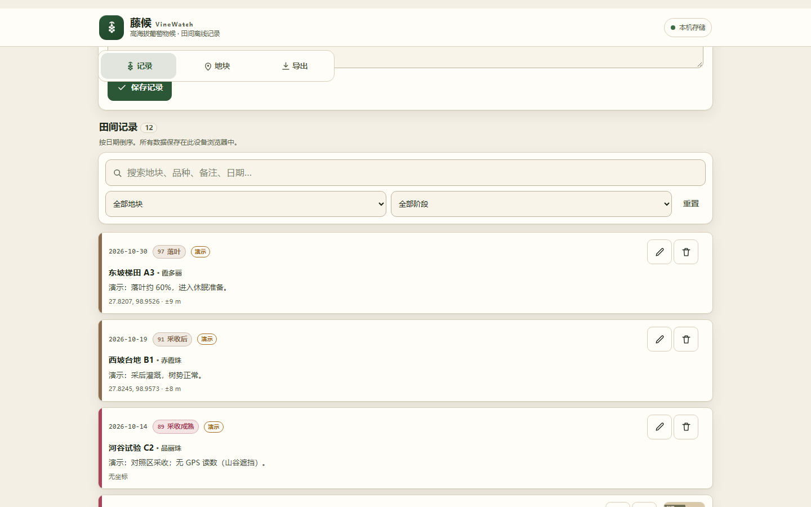

# 藤候 VineWatch

离线优先的高海拔葡萄物候（BBCH）田间记录 PWA：按地块记下阶段、日期、GPS、照片与备注，**所有数据只留在本机**，随时导出 CSV / GeoJSON。

[](https://github.com/uppercrusteve/vinewatch/actions/workflows/ci.yml)
[](LICENSE)
[](package.json)
[](manifest.webmanifest)
[](tests/)



<p align="center"><sub>桌面端记录视图；截图为载入合成演示数据后的真实运行结果。</sub></p>

## 为什么做

山区葡萄园常没有手机信号，纸质表格又要二次录入、容易抄错阶段和日期。云端记录器一旦断网就停摆，照片还会先被上传。藤候把整条记录路径做进浏览器：打开即用、断网可记、照片在本地压缩、数据随时整包带走，不需要账号或服务器。

**在线演示：** <https://uppercrusteve.github.io/vinewatch/>

## 功能

- 23 个葡萄 BBCH 关键阶段，按萌芽、展叶、花序、开花、坐果、转色、成熟、衰老分组；每个阶段有一句中文田间说明。
- 记录地块、品种、阶段、日期、可选 GPS 坐标与精度、单张照片、备注。
- 搜索记录，按地块与阶段筛选，编辑与确认删除。
- 地块的新增、重命名、删除；删除地块会级联删除其记录。
- 照片在浏览器内缩放并重编码为 JPEG（长边 ≤ 1280 px），原图不上传。
- 导出 CSV（UTF-8 BOM，Excel 可直接打开）、GeoJSON（仅含坐标记录）与 JSON 全量备份；可重新导入 JSON 并自动去重。
- IndexedDB 本地存储、Service Worker 预缓存、断网刷新可用。
- 统计卡片、深浅色主题、移动优先布局、键盘可操作的标签页。
- 12 条合成演示记录，全部带「演示」标记，可一键载入或清空。

## 安装

需要 Node.js 22+ 与现代浏览器（Chrome / Edge / Firefox / Safari）。

**Windows PowerShell**

```powershell
git clone https://github.com/uppercrusteve/vinewatch.git
cd vinewatch
npm ci
npm test
npm run build
npm run dev
```

**macOS / Linux**

```bash
git clone https://github.com/uppercrusteve/vinewatch.git
cd vinewatch
npm ci
npm test
npm run build
npm run dev
```

打开 <http://127.0.0.1:4173>。`npm run dev` 优先服务 `dist/`，因此先运行 `npm run build`。按 `Ctrl+C` 停止。

## 快速开始

```bash
npm ci
npm run build
npm run dev
```

打开页面后点击「载入示例数据」，即可看到 3 个虚构地块与 12 条演示记录；点「导出」查看 CSV、GeoJSON 与 JSON 的实际输出。所有操作都在本机完成。

### GitHub Pages 与离线安装

在线版由 GitHub Pages 提供：<https://uppercrusteve.github.io/vinewatch/>。首次访问需要联网，Service Worker 缓存完成后即可离线打开和新增记录。

- **Chrome / Edge（桌面）**：地址栏右侧的安装图标，或菜单 →「安装应用」。
- **Android Chrome**：菜单 →「安装应用」或「添加到主屏幕」。
- **iOS Safari**：分享 →「添加到主屏幕」。

建议安装后再开始田间记录。清理浏览器站点数据会删除应用内数据，请定期导出 JSON 备份。

## 输入与输出

| 字段 | 约束 |
|---|---|
| 地块 | 必填；先在地块页建立，名称 ≤ 60 字 |
| 品种 | 可选，≤ 60 字，默认随地块带入 |
| BBCH 阶段 | 必填；只能从内置的 23 个关键码中单选 |
| 日期 | 必填；`YYYY-MM-DD`，2000-01-01 至明天 |
| GPS | 可选；经纬度必须成对出现，精度按浏览器报告值保存 |
| 照片 | 可选，单张；输入 ≤ 25 MB，压缩后长边 ≤ 1280 px |
| 备注 | 可选，≤ 1200 字 |

输出均在浏览器内生成，不经过服务器：

- **CSV**：UTF-8 BOM、CRLF、14 列（记录 ID、地块、品种、海拔、BBCH 编码、阶段、日期、纬度、经度、定位精度、备注、演示标记、创建/更新时间），含逗号、引号、换行或首尾空格的字段会被引号包裹，内部引号翻倍。
- **GeoJSON**：RFC 7946 `FeatureCollection`，仅包含经纬度均为有限数值且未越界的记录，坐标顺序为 `[经度, 纬度]`。
- **JSON 备份**：`schema: vinewatch-export`，含全部地块、记录与内嵌照片；导入时按 ID 和「地块 + 阶段 + 日期 + 坐标 + 精度 + 照片 + 备注」指纹去重，只合并不覆盖。

可直接用 [`examples/demo-backup.json`](examples/demo-backup.json) 在「导出 → 导入 JSON 备份」中试用导入流程。

## 方法与局限

- BBCH 表只裁剪到本项目使用的 23 个关键码（01–97 之间的物候段），**不是完整 0–99 编码**，也不含主梢/副梢的全部细分。
- GPS 使用浏览器 Geolocation API，坐标为 WGS84，精度值来自设备报告；林冠下常显著变差，工具不做差分校正或多次平均。坐标可留空。
- 照片经 canvas 重绘为 JPEG（质量 0.82），**EXIF 不保留**，GPS 必须由应用单独记录；重编码是有损的。
- 导出与存储格式、IndexedDB 结构、离线与隐私边界、已知局限详见 [`docs/methods.md`](docs/methods.md)。

## 数据来源与合成状态

- BBCH 阶段定义与中文说明参考 Lancashire et al. (1991) 与 Coombe (1995)，文献信息见 `docs/methods.md`。
- 应用本身不带实测数据。内置演示集为**合成演示**：3 个虚构地块、12 条记录、3 张 SVG 示意图，坐标以云南德钦附近为参照并加入固定抖动，记录备注以「演示：」开头。
- 仓库截图均来自合成演示数据，不是真实田间观测。

## 测试

```bash
npm test
```

4 个测试文件、49 项测试，覆盖 BBCH 阶段表与排序、日期边界、地块/记录 CRUD、级联删除、搜索筛选、CSV BOM、转义与公式前缀、GeoJSON 坐标过滤、JSON 导入校验与去重、照片缩放与压缩错误路径。测试使用 Vitest + jsdom + fake-indexeddb，不需要浏览器。

生产构建：

```bash
npm run build
```

esbuild 打包到 `dist/` 并输出文件数/体积；构建与测试在 CI 中逐次运行。

## 引用

若在田间工作或教学中使用，请引用：

```bibtex
@software{uppercrusteve_vinewatch_2026,
  author  = {uppercrusteve},
  title   = {VineWatch: Offline-first grape phenology (BBCH) field notebook PWA},
  year    = {2026},
  version = {0.1.0},
  url     = {https://github.com/uppercrusteve/vinewatch},
  license = {MIT}
}
```

机器可读元数据见 [`CITATION.cff`](CITATION.cff)。

## English summary

VineWatch is an offline-first progressive web app for recording grapevine phenology in the field by plot. It offers a trimmed set of 23 BBCH key stages, optional GPS with reported accuracy, client-side photo compression to 1280 px JPEG, notes, search and filters. Records live in IndexedDB and never touch a server; exports include UTF-8 BOM CSV, GeoJSON points with coordinates only, and a JSON backup that can be re-imported with validation and de-duplication. A service worker precaches the shell so the installed app opens offline after the first visit. The BBCH table is a field-oriented subset, not the full 0–99 scale. Built with vanilla HTML/CSS/JS and tested with Vitest in a jsdom + fake-indexeddb environment.

## License

[MIT](LICENSE) © 2026 uppercrusteve
